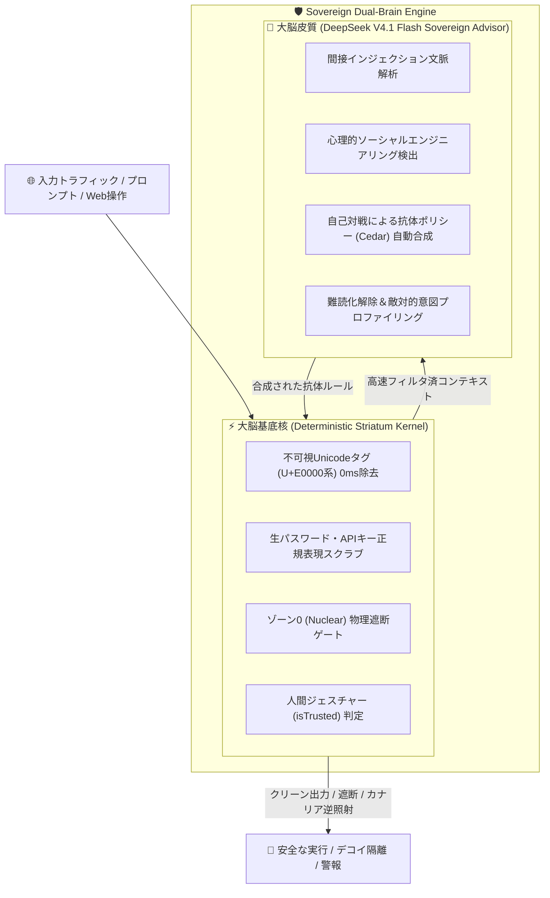

# Aegis-Zero: Sovereign Dual-Brain AI Security & All-in-One Defense Mesh (v4.0)

[](#)
[](#)
[](#)
[](#)
[](#)

> **個人の1クリック要塞化から、自律AIエージェント時代の資産防衛・合法的反撃・自己学習までを統合した「完全自己主権型」セキュリティ基盤**

---

## 🌟 概要 (Overview)

**Aegis-Zero** は、AIエージェントの爆発的普及に伴い急増する「間接プロンプトインジェクション」「不可視Unicodeステガノグラフィ」「サプライチェーンMCP汚染」「認証情報の盗難・不正送金」から、個人および組織の最重要資産（銀行・証券・暗号資産・ソースコード・認証基盤）を防御するためのセキュリティシステムです。

単なる受動的ファイアウォールにとどまらず、**「二重脳（Dual-Brain）アーキテクチャ」**と**「能動的反撃（Active Deception）」**、そして**「自律脅威自己学習（Antifragile）」**を融合させています。さらに **v3.2** では、正規権限を持つオーナーの快適な操作性を妨げない **Silent Privilege Guard** を実装し、バックグラウンドで静寂かつ堅牢に稼働します。

---

## 🧠 二重脳（Dual-Brain）アーキテクチャ

LLMの柔軟な推論力と、決定論的コードの絶対的な正確性を分離・連携させた構造を採用しています。



1. **大脳皮質 (Persona & Deep Reasoner)**:
   - **DeepSeek V4.1 Flash Sovereign Advisor**
   - 複雑な文脈理解、多段階難読化の解除、プロンプトインジェクションの論理的判定、最新の攻撃手口に基づく抗体生成を担当。
2. **大脳基底核 (Deterministic Striatum Kernel)**:
   - **TokenZero 決定論的カーネル**
   - 誤差0%・遅延0ms・計算コストゼロ。固定式（Formula-First）、正規表現、オントロジー制約、ハードウェア安全領域（Secure Enclave / Touch ID）に基づき、危険な操作や平文秘密情報の漏洩を物理的に強制遮断。

---

## 🚀 主要機能 (Core Features)

### 1. AI Shield & 不可視プロンプトインジェクション防衛
- **不可視Unicodeタグ文字（U+E0000〜U+E007F）の完全無害化**: 人間の目に見えずAIだけに解読される隠し命令を自動パージ。
- **多段Base64 / ゼロ幅スペース難読化の多重解除**: 難読化された悪意あるペイロードを検知・展開してブロック。
- **MCPツール汚染（Tool Poisoning / Rug-Pull）検知**: 外部MCPサーバーが秘密鍵やSSHキーを不正奪取しようとする動作を遮断。

### 2. Browser Guard (Chrome Extension v3.2)
- **リアルタイムWeb AI入力保護**: ChatGPT, Claude, Gemini, DeepSeek などのWebチャット入力欄を常時監視。
- **Silent Privilege Guard**: 人間の手動操作（`isTrusted === true`）は一切ブロックせずスムーズに通過。自動化スクリプトやAIエージェントによる無断送信のみをバックグラウンド検査。
- **1クリックUndo通知トースト**: 誤置換が発生した場合、ユーザーがワンクリックで直前の入力へ戻せる安心設計。
- **コード識別子保護**: `delete_user_session` や `api_key_param` などのソースコード変数名を誤ってマスキングしない識別子セーフガード。

### 3. Blind Credential Broker & 3層資産ゾーニング
AIエージェントに生パスワードや秘密鍵を決して渡さない「ブラインド・ハンドル方式」を採用。
- **Zone 0 (Nuclear)**: 銀行、証券口座、仮想通貨コールドウォレット、基幹メール。AI操作は物理遮断（Read-Only監査のみ）。
- **Zone 1 (Guarded)**: クラウドインフラ（AWS/GCP）、GitHub、主要SaaS。AIには `handle://zone1/github_pat` の不透明ポインタのみを提供し、平文はローカルプロキシ層でのみ展開。
- **Zone 2 (Ephemeral)**: 一般Webサービス、SNS、検証用環境。1口座1エイリアス（SimpleLogin連携）＋自動破棄。

### 4. 能動的反撃（Active Counter-Deception）
違法な不正アクセス（Hack-Back）を排除し、完全合法なディセプション技術で反撃。
- **Poisoned Honey-Vault (Canarytokens)**: 偽の証券APIキーや偽ウォレット秘密鍵を囮として配置。不正アクセス発生時に攻撃者のIP・端末情報・C2通信を即座に逆探知。
- **Dynamic Web Tarpit**: 侵入者をLLMがリアルタイム生成する偽のOS・仮想API・架空の金融画面に隔離し、攻撃者の時間と計算資源を浪費させる（シミュレーション）。
- **攻撃者プロファイリング**: 既知のOSデーモン（`mds`, `backupd` 等）を自動識別して誤警報を排除しつつ、真の攻撃者のみを抽出。

### 5. マシン・端末姿勢ライブスキャナー (Mac & Windows)
- **Mac**: Gatekeeper, FileVault, SIP (System Integrity Protection), アプリケーションファイアウォール, SSH鍵パーミッション（0600強制）を瞬時に診断。
- **Windows**: BitLocker, Windows Defender, ファイアウォール, SSH鍵アクセス権（icacls）を診断。
- **1クリック修復**: セキュリティ欠落部分を検出し、ワンクリックで推奨安全設定へ自己修復。

### 6. Zero-Knowledge パスワードCSVインポーター
- Chrome / Safari / 1Password / Bitwarden のエクスポートCSVをドラッグ＆ドロップするだけで、平文パスワードの強度・使い回し・漏洩リスクを完全ローカルで診断。
- 解析完了直後にメモリ上の平文データを物理的にシュレッダー破棄（ゼロクリア）。外部通信は一切行いません。

### 7. 反脆弱性・自律脅威学習（Antifragile Learning）
- CISA KEV（悪用確認済み脆弱性カタログ）や脅威インテリジェンスフィードから最新のCVE情報を定期収集。
- PyRIT型敵対的自己対戦（Red-Team vs Blue-Team）により、新たな攻撃パターンに対する「抗体ルール（AWS Cedar形式）」を自律合成。
- 正常系トラフィックテスト（誤検知0%）をパスした抗体のみをプロダクションルールへ0秒即時昇格。

### 8. 軽量オールインワン・マルウェア／スパイウェア／ローグウェア防衛 (v4.0)
OSカーネルドライバ（BSODや署名制限の原因）を使わず、GitHub上の実績あるオープンソースセキュリティ設計を統合したユーザー空間・イベント駆動型4層ガード：
- **① ダウンロード即時検疫 (`DownloadsQuarantineScanner` — Inspired by `Neo23x0/Loki` & `signature-base` & `elastic/protections-artifacts`)**:
  - 二重拡張子（`請求書.pdf.exe`）、RTLO文字偽装（U+202E）、MalwareBazaar SHA-256 IOC、および **Atomic macOS Stealer (AMOS)** / **Lumma・Redline Stealer** / **難読化ドロッパー** をYARA-Liteルールで即時検出し、1クリックUndo復元付きの検疫Vaultへ隔離。
- **② 永続化・潜伏ハンター (`PersistenceHunter` — Inspired by `objective-see/KnockKnock` & `BlockBlock`)**:
  - macOSの `LaunchAgents` / `LaunchDaemons` (`.plist`) やWindowsの `Run` レジストリに潜む不審な自動起動プログラムを検出（Apple / Microsoft / Homebrew等の正規ツールは自動ホワイトリスト化し誤検知0%）。
- **③ スパイウェア外部送信 ＆ クリッパー遮断 (`SpywareExfilAndClipperGuard` — Inspired by `objective-see/LuLu` & `stamparm/maltrail`)**:
  - 非ブラウザプロセス（`osascript` 等）がTelegram Bot APIやDiscord Webhook、不審C2へ機密ファイルを送信する通信を検知。
  - コピーした仮想通貨送金先アドレス（BTC / ETH / SOL / TRON）をミリ秒単位ですり替える**クリッパー（Clipper）マルウェア**を検知し、本来のアドレスへ即時自動復元。
- **④ ブラウザ偽警告・サポート詐欺シールド (`BrowserRoguewareShield` — Inspired by `gorhill/uBlock` & Malwarebytes Browser Guard)**:
  - 「トロイの木馬に感染しました」「今すぐサポートへ電話」等の偽ウイルス警告（ローグウェア）と `onbeforeunload` / フルスクリーン画面ロック罠を検知・自動解除。

---

## 📁 ディレクトリ構造 (Project Layout)

```text
aegis-zero/
├── aegis/                         # コア防衛エンジンパッケージ
│   ├── ai_shield.py               # 不可視Unicode除去 & プロンプトインジェクション防衛
│   ├── deepseek_advisor.py        # DeepSeek V4.1 Flash Sovereign Advisor & 静粛制御
│   ├── malware_guard.py           # マルウェア・スパイウェア・永続化・ローグウェア統合防衛 (v4.0)
│   ├── blind_broker.py            # ブラインド認証ブローカー & 3層ゾーニング
│   ├── access_policy.py           # ゾーン判定 & 認可ポリシーエンジン
│   ├── deception.py               # ハニートークン & カウンターディセプション
│   ├── attacker_intel.py          # 攻撃者プロファイリング & テレメトリ解析
│   ├── antifragile.py             # 敵対的自己対戦 & 抗体合成ループ
│   ├── threat_researcher.py       # CISA KEV / 脅威インテリジェンス自動収集
│   ├── mac_live_scanner.py        # Mac / Windows 実機セキュリティ診断
│   ├── importer.py                # ゼロ知識パスワードCSVインポーター
│   ├── server.py                  # ローカルREST API & Web UIサーバー
│   └── cli.py                     # Aegis-Zero CLIツール
├── chrome_extension/              # Browser Guard (Chrome拡張機能 v4.0)
│   ├── manifest.json              # Manifest V3 設定
│   ├── content_script.js          # Webフォーム監視 & 偽警告ローグウェア解除 & Undoトースト
│   ├── background.js              # バックグラウンド検査 & ツールバーバッジ制御
│   ├── popup.html                 # 拡張機能ダッシュボードUI
│   └── popup.js                   # ポップアップロジック
├── data/                          # 免疫データベース & 2FA/Passkeyディレクトリ
│   ├── learned_immunity_db.json   # 自己学習によって合成された抗体DB
│   └── passkey_2fa_directory.json # パスキー対応サービス推奨DB
├── tests/                         # 単体・結合・敵対的攻撃テストスイート (72テスト)
├── Start_Aegis_Mac.command        # macOS 1クリック起動スクリプト
├── Start_Aegis_Windows.bat        # Windows 1クリック起動スクリプト
└── README.md                      # 本ドキュメント
```

---

## 🛠️ インストールと起動手順 (Quick Start)

### 1. 前提条件
- Python 3.10 以上
- Google Chrome（Browser Guardを利用する場合）

### 2. ワンクリック起動 (推奨)

#### macOS:
ファインダーから `Start_Aegis_Mac.command` をダブルクリックするだけです。
（自動的にローカルサーバーが起動し、ブラウザでダッシュボード `http://localhost:8765` が開きます）

#### Windows:
エクスプローラーから `Start_Aegis_Windows.bat` をダブルクリックします。

---

### 3. コマンドラインからの起動

```bash
# 依存関係なし（Python標準ライブラリのみで即時稼働）
cd aegis-zero

# ローカルサーバーの起動 (ポート 8765)
python3 -m aegis.server --port 8765

# または CLI 診断の実行
python3 -m aegis.cli scan       # マシン・端末姿勢の即時スキャン
python3 -m aegis.cli audit      # 資産・認証情報のセキュリティ監査
python3 -m aegis.cli shield     # プロンプトインジェクション対話型防御テスト
```

---

### 4. Chrome拡張機能（Browser Guard）の導入

1. Google Chrome を開き、アドレスバーに `chrome://extensions/` と入力します。
2. 画面右上の **「デベロッパー モード」** をONにします。
3. **「パッケージ化されていない拡張機能を読み込む」** をクリックします。
4. 本リポジトリの `chrome_extension` フォルダを選択します。
5. ツールバーに「Aegis-Zero Guard」の盾アイコンが表示されれば導入完了です。
   - ChatGPT、Claude、DeepSeek等の入力フォームで入力・ペーストされた機密情報や不可視文字が自動検閲されます。
   - バックグラウンドで静かに動作し、誤検知時は1クリックでUndoが可能です。

---

## 📡 REST API エンドポイント一覧

ローカルサーバー（既定: `http://127.0.0.1:8765`）は以下のエンドポイントを提供します。

| メソッド | エンドポイント | 説明 |
| :--- | :--- | :--- |
| `GET` | `/api/mac-posture` | Mac / Windows の端末セキュリティ姿勢診断 |
| `POST` | `/api/ai-shield` | テキストのインジェクション・不可視文字・機密情報検査 |
| `POST` | `/api/ai-dual-brain` | DeepSeek V4.1 Flash Sovereign Advisor による二重脳詳細診断 |
| `POST` | `/api/browser-guard` | ブラウザDOM・ダークパターン・プロンプト汚染の検査 |
| `GET` | `/api/malware-guard/status` | マルウェア・スパイウェア・永続化・ローグウェア統合ガード状態取得 (v4.0) |
| `POST` | `/api/malware-guard/scan` | ダウンロード検疫・永続化ハンター・C2/クリッパー・偽警告DOM統合スキャン (v4.0) |
| `POST` | `/api/import-csv` | パスワードCSV（Chrome/1Password）のゼロ知識インメモリ解析 |
| `POST` | `/api/deploy-baits` | おとりファイル（カナリア罠）のローカル配備 |
| `POST` | `/api/trigger-counter` | 能動的反撃・証拠チェーン・抗体合成シミュレーション |
| `POST` | `/api/research-self-train` | 脅威リサーチ＆敵対的自己対戦サイクルの手動トリガー |

---

## 🧪 テストの実行 (Verification)

本リポジトリは、過酷な敵対的攻撃シミュレーションを含む包括的なテストスイートを備えています。

```bash
# 全体テストスイートの実行 (72/72 PASS)
python3 -m unittest discover -s tests -v
```

---

## 🔒 セキュリティと法務遵守 (Security & Compliance)

- **完全合法なアクティブ・ディセプション**:
  攻撃者サーバーへ不正アクセスを仕掛ける「違法なHack-Back」は一切行いません。自社・個人環境内での囮配置、隔離、リソース遅延（Tarpit）、および公的機関・セキュリティネットワークへの自動通報のみを実施します。
- **ゼロ知識・完全ローカル処理**:
  パスワード、暗号鍵、機密プロンプトが外部サーバーへ送信されることはありません。すべての正規表現検査、CSV解析、メモリ破棄は手元のマシン内で完結します。

---

## 📄 ライセンス (License)

Copyright (c) 2026 kodawarimax. All rights reserved.
本ソフトウェアおよび関連文書はプライベート資産であり、無断での複製、改変、再配布を禁じます。
